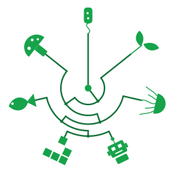

---
# Feel free to add content and custom Front Matter to this file.
# To modify the layout, see https://jekyllrb.com/docs/themes/#overriding-theme-defaults

layout: home
role: home
banner: True
permalink: /
---

My research revolves around Artificial Life in its myriad forms: from Morphogenetic Engineering to Open-Ended Evolution, from NeuroEvolution to Artificial Cognition, from swarms to artificial pets.
In this website, you will find some down-to-earth content such as my list of [publications](/publications) or my [CV](/cv) as well as more (hopefully) inspiring information about the specifics of my [research](/research/) lines and current [projects](/projects/).
If you have time to spare, you could also spend it exploring interactive evolution in my implementation of [blind watchmaker](/watchmaker) for the [Splinoids](research/er/splinoids.html) morphological space.
